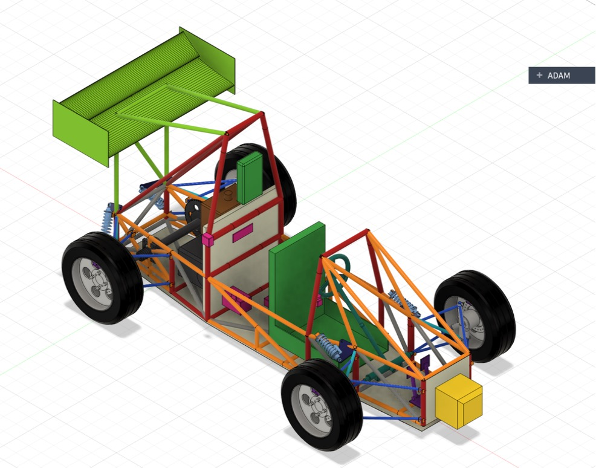

# Nittany Motorsports: NM26 mule


A drivable FSAE test car ("mule") built to the full 2026 FSAE rules, with a rear wing and DRS. Every number in the
design comes from the Python code in `mule/`, and the code checks itself: `python report.py` runs 210 design checks (every frame-relevant FSAE 2026 rule is listed in [`mule/docs/RULES_MATRIX.md`](mule/docs/RULES_MATRIX.md))
and every automated test, and writes `mule/docs/REPORT.md`. GitHub runs the same checks on every push; the badge above
turns red if a change breaks one.



**Status (30 September 2026):** the design is complete and checked; nothing is built yet. Engine chosen: **Honda
CRF450R 2018+** (the 13 hp kit engine doesn't fit the engine bay). Next: measure a CRF450R (gear ratios are already in from the service manual),
build the plywood mock-up, then order frame tube. The full to-do list is in [`WHATS_NEXT.md`](WHATS_NEXT.md).

## I just want to…

| …do this | Go here |
|---|---|
| **Look at the car in CAD** | Download [`mule/cad/NM26_Assembly.step`](mule/cad/NM26_Assembly.step) and open it in Fusion (File > Open > Open from my computer), SolidWorks, Onshape or FreeCAD. It arrives upright, one component per part. Team members with Fusion access: `adi laptop files > Nittany Motorsports > NM26_Assembly_v4` (current; Fusion split the import into `_v4`, `_v4_part2` and `_v4_part3`). Older versions sit in `adi laptop files`, named `..._v1_no_wing`, `..._v2_first_wing`, `NM26_Mule_simple_v1–v3`, `NM26_FSAE_Concept_original`. |
| **Find one part** | [`mule/cad/NM26_Assembly_parts.csv`](mule/cad/NM26_Assembly_parts.csv) lists every part number, what the part is and its file in `mule/cad/parts/` |
| **Get it funded in small steps** | [`mule/docs/BUDGET_PLAN.md`](mule/docs/BUDGET_PLAN.md): five phases of about $2,500 or less, about $7.4–10.9k to a driving car with a used 450, upgrades after |
| **See which parts and engine we're using** | [`mule/docs/PARTS_LIST.md`](mule/docs/PARTS_LIST.md): the chosen parts, engine options with prices, and which script sizes each part |
| **Get the frame quoted by a shop** | [`mule/quote/`](mule/quote): send the whole folder; [`README_FOR_SHOP.md`](mule/quote/README_FOR_SHOP.md) explains it. Rebuild with `python quote_package.py` after any frame change |
| **Know what to buy and build** | [`mule/docs/BUILD_PLAN.md`](mule/docs/BUILD_PLAN.md): §4 bill of materials, §5 build order, the rules checklist; tube cuts and bends are in [`mule/fab/`](mule/fab) |
| **Test the built car** | [`mule/docs/TEST_PLAN.md`](mule/docs/TEST_PLAN.md): each test, the predicted value and the pass criteria |
| **Know how far to trust the simulations** | [`mule/docs/SIM_TO_REAL.md`](mule/docs/SIM_TO_REAL.md): every model's valid range, error type, covering margin and the test that measures it (sim-to-real, after NVIDIA's course) |
| **Check we meet every FSAE rule** | [`mule/docs/RULES_MATRIX.md`](mule/docs/RULES_MATRIX.md): every frame-relevant 2026 rule, automated check or build item, nothing traded |
| **See the requirements and results** | [`mule/docs/PDS.md`](mule/docs/PDS.md) (targets) and [`mule/docs/REPORT.md`](mule/docs/REPORT.md) (every check and its result) |
| **See what's been done, and what's next** | [`WORKDONE.md`](WORKDONE.md) (summary of all work) and [`WHATS_NEXT.md`](WHATS_NEXT.md) (the to-do list, in order) |
| **Understand why something is the way it is** | [`mule/docs/PROJECT_LOG.md`](mule/docs/PROJECT_LOG.md), step by step, including every mistake found and fixed |
| **Change the design** | See below |

## Quick start (run the design code)

Needs Python 3.11 (CadQuery does not support newer versions everywhere yet). About 5 minutes the first time. No MATLAB needed.

```bash
git clone https://github.com/udayjain2102/nittanymotorsports.git
cd nittanymotorsports
python3.11 -m venv .venv
source .venv/bin/activate          # Windows: .venv\Scripts\activate
pip install -r requirements.txt
cd mule
python report.py                   # every design check + every test -> docs/REPORT.md (about 1 min)
```

On a Mac, VS Code's Source Control needs git, which Apple ships with Xcode: run `sudo xcodebuild -license accept`
once, or install GitHub Desktop, which brings its own git.

## Changing the design

1. Make a branch: `git switch -c my-change`.
2. Edit the number where it lives. All geometry is in `mule/mule.py`, and each system's own values are at the top of
   its script (e.g. `springs.RIDE_HZ`, `brakes.MC_BORE`, `aero.COEF`). `mule/README.md` lists every assumption and
   where it is set.
3. Run `python report.py` in `mule/`. A failed check names the rule or target and prints the number that missed.
4. Re-export what you changed: `python mule.py` (simple CAD, drawings), `python cad_parts.py` (detailed CAD, ~3 min),
   `python fab.py` (shop data).
5. Add a line to `mule/docs/PROJECT_LOG.md` saying what changed and why, then commit, push and open a pull request.
   GitHub runs every check on it.

For a summary of everything done so far, read [`WORKDONE.md`](WORKDONE.md). For the to-do list, see [`WHATS_NEXT.md`](WHATS_NEXT.md).

Start with [`mule/README.md`](mule/README.md) (how to run it, the colour key, all assumptions), then
[`mule/docs/PROJECT_LOG.md`](mule/docs/PROJECT_LOG.md) (what was done, why, and what is still open).

## What each file contains

### Folder layout
```
README.md, requirements.txt   this page and the Python packages
mule/                         the car: all design scripts (*.py) sit here because they import each other
  docs/                       requirements, build plan, test plan, project log, generated report
  cad/                        detailed CAD: assembly, parts/, parts list, routing, drawings
    simple/                   simple CAD model, its parts list, and the frame-only FEA model
  fab/                        shop data: tube order list, cut sheet, hoop bend programs, jig coordinates
  quote/                      frame quote package for the shop: frame STEP, material list, shop data, cover note
  views/                      drawings of the simple model and the colour key
  tests/                      automated tests (pytest)
history/                      frozen copy of mule/ for every frame version (frame_v1_50.1kg, frame_v2_46.4kg, ...); never edited or deleted
references/                   other teams' papers (local only, not in git)
```

### Documents (`mule/docs/`)
| File | Contains |
|---|---|
| `README.md` | How to set up and run the code, the output files, the CAD colour key, every assumption, known limits |
| `PDS.md` | Product design specification: the requirements R1–R15 with targets and results, decisions, Pugh matrices, the FSAE Michigan 2025 benchmark |
| `BUDGET_PLAN.md` | Phased funding plan: what each phase buys, cheap choices, the upgrade path, price sources |
| `SIM_TO_REAL.md` | How far to trust each simulation: valid range, error type, margin, the test that measures it, and the real-to-sim loop |
| `RULES_MATRIX.md` | Every frame-relevant FSAE 2026 rule (V.1, F, T.1, T.2) with its status: automated check, build/inspection item, or not applicable and why |
| `FRAME_RESEARCH.md` | How lighter FSAE steel frames are built (sources), applied to NM26 |
| `PARTS_LIST.md` | Bought parts the design uses and the options still open, engine candidates first |
| `BUILD_PLAN.md` | The design narrative by system (§1–2n), the FSAE rules checklist, the bill of materials, the build sequence, the buck plan |
| `TEST_PLAN.md` | Physical tests, stages 1–7: what each proves, the predicted value, the procedure, pass criteria, and a results log |
| `PROJECT_LOG.md` | Chronological record of every step, method, result, error and fix; current results; open items |
| `REPORT.md` | Generated by `report.py`: every design check and every test with its outcome. Don't edit it by hand. |

### CAD and shop data (`mule/cad/`, `mule/fab/`)
| File | Contains |
|---|---|
| `cad/simple/NM26_Mule.step` | Simple full-car model (tubes, boxes, cylinders), one colour per system; made by `mule.py` |
| `cad/simple/NM26_Mule_parts.csv` | Part number, name and colour of every body in `NM26_Mule.step` |
| `cad/simple/NM26_Frame_FEA.step` | Frame only, one solid per tube, for Fusion Simulation; made by `frame_fea_export.py` |
| `cad/NM26_Assembly.step` | Detailed full-car assembly (tread, springs, CV boots, rockers, tabs), in 9 sub-assemblies; made by `cad_parts.py` |
| `cad/parts/NM26-<system>-<nnn>_<name>.step` | One file per detailed part, already in its assembly position (Z-up). Every name is unique: frame tubes carry their size, role, side and number (bottom to top), and tabs carry the frame point they are welded at |
| `cad/NM26_Assembly_parts.csv` | Part number, name, sub-assembly, colour, file, and **what each file contains**, for every detailed part |
| `cad/view_*.svg`, `cad/view_*.png` | Drawings of the detailed assembly (iso, side, front, top) |
| `views/simple_*.svg`, `views/*.png`, `views/NM26_fusion_view.jpg` | Drawings of the simple model, plus the Fusion screenshot of the detailed car at the top of this page; `colour_key.png` explains the colours; `suspension_corners.png` shows the suspension corners |
| `fab/tube_order_list.csv` | Frame tube lengths and masses by size and role |
| `fab/tube_cut_sheet.csv` | Every frame piece: size, cut length, cope angles at each end |
| `fab/hoop_bend_program.csv` | Bend programs (feed / rotation / bend) for both roll hoops |
| `fab/jig_node_coordinates.csv` | Frame-jig coordinates of every joint |
| `fab/jig_plan.png` | Jig plan drawing |

### Code (`mule/`)
Each design script checks itself when run (`python <file>`); `report.py` runs them all.
| File | Designs and checks |
|---|---|
| `frame_opt.py` | Tube-size optimiser: smallest tubes that pass every gate (strength, rules, compliance, tolerances), written back into `mule.py` |
| `robustness.py` | Reality-gap check: re-runs every frame load case with tube walls ±10 %, joints ±2 mm and joint flex; tilt with mass errors; brake and lap-time bands |
| `frame_rules.py` | FSAE frame-structure rules not covered by `mule.py`: tube size per job, side-view triangulation, hoops, braces, bulkhead and brace supports, side impact, shoulder bar, mounts off the main hoop, steering protection, hips in the Major Structure, open-wheel zones |
| `mule.py` | **The single source of geometry**: frame nodes and tubes, suspension points, CAD export, 27 FSAE rule checks |
| `fea.py` | Frame beam FEA: torsional stiffness, roll-hoop loads (AF4.1/AF4.2) |
| `suspension.py`, `steering.py`, `sideview.py`, `roll.py`, `compliance.py` | Suspension and steering kinematics: roll centres, camber, bump steer (front and rear), Ackermann, caster, steering ratio and effort, handling balance, static camber, jacking, compliance steer |
| `loads.py`, `springs.py`, `rocker.py`, `uprights.py` | Wheel loads through the links into the frame, springs and dampers, rockers and shocks, uprights, hubs and bearings |
| `powertrain.py`, `brakes.py` | Engine (CRF450R 2018+), gearing, chain, CV shafts, engine mounts, launch load, kit-engine fit check; brake sizing, pedal box, BOTS, 2000 N pedal test |
| `cockpit.py`, `harness.py`, `mass.py`, `shutdown.py` | Cockpit templates, harness mounts and 20 g crash, mass and CG budget with the tilt test, 12 V shutdown circuit and wiring |
| `aero.py` | Rear wing with DRS flap: rules geometry, forces, mounts, servo, failsafe logic |
| `lapsim.py` | Point-mass acceleration, skidpad and autocross, with the wing; benchmark times |
| `fab.py`, `views.py`, `frame_fea_export.py`, `cad_parts.py`, `quote_package.py` | Shop data, drawings, the frame-only STEP, the detailed per-part CAD, the shop quote package |
| `report.py` | Writes `docs/REPORT.md` (all checks and tests) and the README colour key |
| `fusion_gd.py` | Fusion Generative Design frame study (curiosity): keep/keep-out STEP files and the 5 load cases in `fusion_gd/` |
| `snapshot.py` | `python snapshot.py <name> [commit]`: freezes `mule/` at a commit into the top-level `history/<name>/` before anything is regenerated (never overwrites) |
| `tests/` | `pytest -q tests`: hand calculations, limiting cases, and a guard that `docs/TEST_PLAN.md` quotes current numbers |

### Repo files (top level)
| File | Contains |
|---|---|
| `WHATS_NEXT.md` | The to-do list, in order: measure the engine, mock-up, funding steps, build, tests, upgrades |
| `WORKDONE.md` | Overview of all the work done so far: every system, the problems found and fixed, CAD, documents, GitHub, each day's work, open items |
| `requirements.txt` | The four Python packages the code needs (CadQuery, NumPy, Matplotlib, pytest) |
| `.github/workflows/tests.yml` | GitHub Actions: installs the packages and runs `python report.py` on every push and pull request |
| `.gitattributes` | Marks CAD, drawings and generated reports as generated, so diffs show only real changes |
| `.gitignore` | Keeps Python caches, session folders and `references/` (third-party papers) out of the repo |

