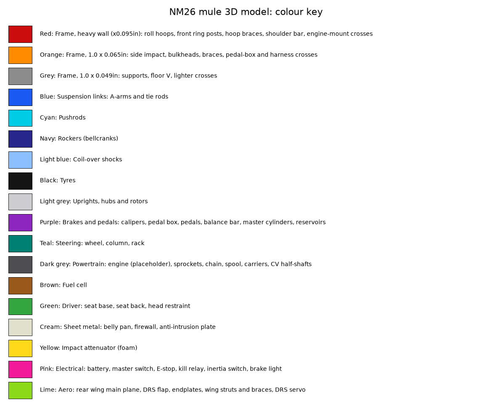

# NM26 FSAE-lite mule: design code

This folder holds the parametric design for a drivable mule that follows the FSAE 2026 safety rules. Every number in the design comes from these scripts. Each script checks its own targets and exits with an error when one is missed. `tests/` runs all of those checks together.

The requirements (numbers plus how each is verified) are in [PDS.md](docs/PDS.md). The design narrative (critique of the concept, rules checklist, BOM and build order) lives in [BUILD_PLAN.md](docs/BUILD_PLAN.md). The physical test plan, with pass criteria taken from these scripts, is [TEST_PLAN.md](docs/TEST_PLAN.md). The chronological log of what was done is [PROJECT_LOG.md](docs/PROJECT_LOG.md).

## Setup

```bash
python3.11 -m venv .venv && source .venv/bin/activate
pip install -r ../requirements.txt     # cadquery, numpy, matplotlib, pytest
```

## Run

```bash
pytest -q tests            # everything (about 45 s; the cockpit template sweep is the slow part)
python mule.py             # rule checks, then writes cad/simple/NM26_Mule.step, fab/tube_order_list.csv, views/simple_*.svg
python cad_parts.py        # detailed CAD (~3 min): cad/parts/*.step (one file per part), cad/NM26_Assembly.step, cad/NM26_Assembly_parts.csv
python fab.py              # fab/tube_cut_sheet.csv, fab/hoop_bend_program.csv, fab/jig_node_coordinates.csv, fab/jig_plan.png
python report.py           # docs/REPORT.md: every design check + every test with its outcome (regenerate after any change)
```

Every script can also be run on its own (`python fea.py` and so on). Each one prints its numbers and exits non-zero on a failed check.

## Outputs

| File | What it is | Open with |
|---|---|---|
| `cad/simple/NM26_Mule.step` | **CAD**: the full car assembly (frame, suspension, uprights, powertrain, brakes, pedal box, pan) | Fusion, SolidWorks, Onshape, FreeCAD |
| `cad/simple/NM26_Frame_FEA.step` | **CAD**: frame only, one solid per tube, for simulation | Fusion Simulation (Combine the bodies first) |
| `fab/tube_cut_sheet.csv`, `fab/hoop_bend_program.csv`, `fab/jig_node_coordinates.csv`, `fab/tube_order_list.csv` | Shop data: tube cuts and copes, bend programs, jig coordinates | Excel / Sheets |
| `views/*.png`, `views/simple_*.svg`, `fab/jig_plan.png` | 2D drawings | Any image viewer |
| `cad/simple/NM26_Mule_parts.csv` | Part number (`NM26-<system>-<nnn>`), name and colour of every body in `NM26_Mule.step` (the simple model) | Excel / Sheets |
| `docs/REPORT.md` | Every check and test, with results (generated) | Markdown |
| `docs/PROJECT_LOG.md`, `docs/BUILD_PLAN.md`, `docs/TEST_PLAN.md` | History, design narrative plus BOM, physical test plan | Markdown |

The `.py` files are the source. The STEP files are generated from `mule.py`, so edit the scripts, not the STEP.

## Detailed CAD (`cad/`)

`python cad_parts.py` builds the car again from the same geometry inputs, with real features instead of primitives
(treaded tyres on spoked rims with lug nuts, hubs with studs, drilled rotors, calipers with pistons, A-arms with rod
ends and ball joints, plate rockers, coil-overs with helical springs, CV shafts with bellows boots, toothed sprockets,
a finned engine, pickup tabs and rocker bushings on the frame). It writes:

- `cad/parts/NM26-<sys>-<nnn>_<name>.step` - one file per part (258), each already at its assembly position, Z-up.
- `cad/NM26_Assembly.step` - the whole car as a nested assembly: `01_frame_weldment` (every tube and bracket as a
  body), `02_corner_<axle>_<side>` x4, `03_cockpit`, `04_powertrain`, `05_body`, `06_electrical`.
- `cad/NM26_Assembly_parts.csv` - part number, name, sub-assembly, colour, file, and what each file contains. Every name is unique: frame tubes carry their side and position, tabs the frame point they sit at. `tests/test_cad_parts.py` checks the three agree.
- `cad/view_*.svg` / `.png` - line drawings of the assembly (`view_engine`, `view_routing_top` are close-ups).
- `cad/ROUTING.md` - every brake line, the throttle cable, the fuel line and every harness wire: from, to, waypoints.

`cad_detail.py` holds the detailed component models: the engine as 15 parts (crankcase, clutch and stator covers,
finned cylinder, head and cam cover, coil, throttle body with injector, airbox with the 20 mm restrictor, header,
muffler, oil filter, starter, gear lever, mount brackets), the cockpit and electrical parts as real shapes (curved seat
shell, padded head restraint, pedal box with cheeks and pivot, dash with E-stop/start/DRS buttons, rotary master
switch, mushroom E-stop, inertia switch, relay, ECU, fan, battery with strap, BOTS, fuel cell with pump and filler),
and `routes()`: the `08_routing` sub-assembly, brake lines (purple), throttle cable (purple), fuel line (brown) and
12 V wiring (pink) as tubes along the frame from the `shutdown.py` netlist and the pedal/caliper positions. The engine
is still a generic 450 cc single at the right size and place; swap in the chosen engine's model when it is known.

In Fusion, open `NM26_Assembly.step` for the full car (each part becomes a component). To assemble from the part
files instead, Insert each part STEP and leave it at the origin: no joints are needed to line the parts up. The frame
is one welded part in reality; its tubes are separate files so each cut length can be drawn, and they all live in the
frame sub-assembly. Colours follow the key below.

## Colour key (3D model)

Each system has one colour in `NM26_Mule.step`. The table below comes from `mule.COLORS` (it's rewritten by `python report.py`). The swatches are in [views/colour_key.png](views/colour_key.png). The 2D layout views (`views/mule_3view.png`) colour the frame by tube size and have their own legend.



<!-- colour-key -->
| Colour | What it is |
|---|---|
| Red | Frame, heavy wall (x0.095in): roll hoops, front ring posts, hoop braces, shoulder bar, engine-mount crosses |
| Orange | Frame, 1.0 x 0.065in: side impact, bulkheads, braces, pedal-box and harness crosses |
| Grey | Frame, 1.0 x 0.049in: supports, floor V, lighter crosses |
| Blue | Suspension links: A-arms and tie rods |
| Cyan | Pushrods |
| Navy | Rockers (bellcranks) |
| Light blue | Coil-over shocks |
| Black | Tyres |
| Light grey | Uprights, hubs and rotors |
| Purple | Brakes and pedals: calipers, pedal box, pedals, balance bar, master cylinders, reservoirs |
| Teal | Steering: wheel, column, rack |
| Dark grey | Powertrain: engine (placeholder), sprockets, chain, spool, carriers, CV half-shafts |
| Brown | Fuel cell |
| Green | Driver: seat base, seat back, head restraint |
| Cream | Sheet metal: belly pan, firewall, anti-intrusion plate |
| Yellow | Impact attenuator (foam) |
| Pink | Electrical: battery, master switch, E-stop, kill relay, inertia switch, brake light |
| White | Aero: rear wing main plane, DRS flap, endplates, wing struts and braces, DRS servo |
| Gold | Routing: brake lines (hard line and flexible hose) and the throttle cable |
| Magenta | Routing: 12 V harness wires (battery, master switch, shutdown loop, ignition, fuel pump, starter, fan, brake light, DRS) |
<!-- /colour-key -->

In Fusion, press Shift+N to toggle component colours if everything shows grey.

## Coordinates and units

The units are mm, N and kg. The axes are:
- **X** points forward, with the rear axle at X = 0.
- **Y** points up, with the ground at Y = 0.
- **Z** points to the driver's right.

These match `NM26_FSAE_Concept.step`. STEP exports are rotated to Z-up, so they come into Fusion upright.

## Files

| File | What it does | Checks |
|---|---|---|
| `mule.py` | **Single source of geometry.** Holds the parameters, the frame nodes and members (tube size per rule role), the suspension hardpoints (`SUSP`, `susp_links`), the belly pan, and the CAD assembly export. | 27 FSAE rule checks (V, F, T), e.g. hoop geometry, helmet clearance, side-impact height, IA, harness angles, tube sizes |
| `fea.py` | 3D beam FEA of the frame, rigid welded joints. | Torsional stiffness; main and front hoop top loads (6/5/9 kN) at a safety factor above 1 against welded yield |
| `suspension.py` | Front-view double-wishbone kinematics over ±50 mm travel (design travel +50 / −25 mm). | Roll centre, camber gain, ball joints inside the 13″ wheel, KPI/scrub (front ≤ 40 mm), no lock-up |
| `roll.py` | Roll gradient, front/rear lateral load transfer distribution (handling balance), static camber and camber to the ground in a corner, roll-centre position in roll, jacking. | LLTD 0–12 points above the front weight share; roll 0.5–2 °/g; outside tyre −2.0 to −0.3° at 1.5 g; RC stays above ground; jacking lift ≤ 5 mm |
| `compliance.py` | Compliance steer and camber: frame pickup deflection (FEA) plus link stretch, upright solved on its six links. | Toe and camber change ≤ 0.25° at the 1.5 g corner load |
| `loads.py` | Six-link upright statics for bump, cornering and braking. Link forces go into the frame through the rockers, and are balanced by the car's inertia (inertia relief). | Frame safety factor under wheel loads; Euler buckling of every link |
| `rocker.py` | Bellcrank design: pushrod to rocker at a frame node, shock to a frame node on a bracket. | Shock stays inside its stroke, motion ratio matches `springs.py`, not regressive, rocker swing, shock clearance to tubes and rods |
| `springs.py` | Pushrod motion ratio × rocker ratio, then spring rate, stroke and damping. | Springs and stroke fall in the common MTB coil-shock range |
| `steering.py` | Bump steer (front and rear), Ackermann, rack travel, and 3D tyre clearance at full lock. | ≤ 0.25° bump steer front and rear, rack travel, 0–120 % Ackermann, ≥ 10 mm clearance |
| `uprights.py` | Uprights and hubs: bearing loads, static rating and life; hub shaft (bending plus drive torque); upright arm stress; wheel-stud slip; rotor and caliper packaging. | s0 ≥ 1.5, L10 ≥ 3× 2000 km, FoS ≥ 1.5 on hub and arms, studs ≥ 1.5× wheel torque, rotor/caliper inside the rim, 10 mm rotor gap |
| `powertrain.py` | Gearing, chain drive, CV half-shafts, engine mounts, and the frame under a full-traction launch (chain loop plus rear tyre force). | Top speed 100–130 km/h; 1st gear reaches traction; chain centre distance, wrap, even links inside the adjustment, tension safety ≥ 4, clearances; CV angle and plunge; launch FoS ≥ 1.2 |
| `brakes.py` | Caliper and master-cylinder sizing, balance-bar bias, lock-up pedal force, pedal travel and BOTS position, rotor heat per stop, pedal/pivot/balance-bar strength, and the frame under the 2000 N pedal load. | Lock all 4 at μ 1.5 with ≤ 600 N; balance range for μ 1.0–1.5 fits the adjuster; pressure at 2000 N ≤ limit; BOTS ≥ 10 mm beyond normal travel and ≥ 10 mm before a lost circuit bottoms; FoS ≥ 1.5 on pedal, pivot and bar; frame FoS ≥ 1.2; master cylinders inside the F.8.6.3 stack-up; rotor ΔT ≤ 150 °C |
| `cockpit.py` | T.1.1 cockpit-opening and T.1.2 leg-room templates swept through the frame, rack, rockers, shocks and seat | Both templates pass |
| `sideview.py` | Caster, trail, anti-dive and anti-squat, pitch, roll-centre migration, bump steer at full lock, steering ratio, steering effort and kickback, turning circle | Caster 3–7°, trail 5–30 mm, anti 0–40 %, dive/squat ≤ 60 % of travel, RC migration ≤ 2:1, lock bump steer ≤ 0.5°, ratio 4–7:1, lock-to-lock ≤ 180°, rim force ≤ 120 N at 1.5 g |
| `aero.py` | Rear wing with a DRS flap: T.7 geometry at both flap positions, forces, axle split, mount FEA (IN.6.2 push, top-speed load, natural frequency), servo and return-spring sizing, DRS logic. | T.7.3–T.7.7 limits; push ≤ 25 mm; FoS ≥ 1.5; first mode ≥ 25 Hz; servo torque; DRS cuts drag ≥ 50 %; front keeps ≥ 90 % load |
| `lapsim.py` | Point-mass acceleration (75 m), skidpad and a representative 0.8 km autocross (D.11.1.1 layout), drag estimate, sensitivities, and the FSAE Michigan 2025 benchmark times. | Acceleration ≤ 5.0 s, skidpad ≤ 5.5 s, autocross average ≥ 40 km/h; drag does not limit top speed |
| `mass.py` | Mass and CG budget for every item | The load-case assumptions (mass, CG, split, unsprung) cover the budget; tilt ≥ 60° |
| `harness.py` | T.2 belt geometry, tab tear-out and weld strength, 20 g harness crash load on the frame | Lap 45–65°, anti-sub ≤ 20°, shoulder −20..+10°, tabs ≥ 15 kN, frame FoS ≥ 1 vs welded UTS |
| `shutdown.py` | 12 V system and shutdown circuit as a simulated netlist, with wire sizing | Each shutdown device kills ignition and the fuel pump; fuses/ampacity; switch ratings; voltage drop; locations (T.9) |
| `report.py` | Writes `docs/REPORT.md`, listing every check and every test with its result | — |
| `fab.py` | Fabrication package: pieces, cope/notch data, hoop bend programs, jig node table. | Hoops bendable (straight between bends ≥ 0), CLR ≥ 3×OD, no tube coping onto a smaller one |
| `tests/test_test_plan.py` | Keeps the predicted numbers quoted in `docs/TEST_PLAN.md` in sync with the code | Fails if any quoted prediction drifts |
| `views.py` | Layout PNGs: `views/mule_3view.png` and the corner front views `views/suspension_corners.png`. | — |
| `frame_fea_export.py` | Frame-only STEP for Fusion Simulation. Combine the bodies in Fusion first. | — |

## Assumptions (change here, then re-run `pytest`)

| What | Value | Where |
|---|---|---|
| Hoop load case | 6 kN lateral, 5 kN rearward, 9 kN down. **Not verified against the current SES.** | `fea.py` `run()` |
| Welded steel yield | 180 MPa (F.3.4.2) | `fea.py` `SY_WELD` |
| Car + driver mass, CG height, front split | 300 kg, 345 mm, 45 %. These must cover the `mass.py` budget with the rear wing: 296 kg, 340 mm, 46 %. | `loads.py`, `mass.py` |
| Tyre grip for design cases | 1.5 | `loads.py` `MU` |
| Ride frequency front/rear, unsprung mass, tyre rate | 3.0/2.6 Hz (front stiffer for balance), 15 kg, 120 N/mm | `springs.py` |
| Motion ratios front/rear (the rocker ratios follow) | 0.72 / 0.75; travel 50 mm bump, 25 mm droop | `springs.py` `MR`, `TRAVEL`, `DROOP` |
| Static camber front/rear | −2.5° / −2.0° | `roll.py` `STATIC_CAMBER` |
| Drag area, rolling resistance, shift time | 1.0 m² (assumed, no wings), 0.02, 0.1 s | `aero.py` | Rear wing with a DRS flap: T.7 geometry at both flap positions, forces, axle split, mount FEA (IN.6.2 push, top-speed load, natural frequency), servo and return-spring sizing, DRS logic. | T.7.3–T.7.7 limits; push ≤ 25 mm; FoS ≥ 1.5; first mode ≥ 25 Hz; servo torque; DRS cuts drag ≥ 50 %; front keeps ≥ 90 % load |
| `lapsim.py` |
| Shock | 230×65 mm at 36 % of stroke; pushrod arm 90 / 70 mm; mount brackets | `rocker.py` |
| Steering stop | 23° inner wheel | `steering.py` `LOCK_DEG` |
| **Engine (placeholder: generic 450 single)** | redline 11 500 rpm, 50 N·m, primary 2.6, gears 2.0–1.0, envelope, countershaft at X=200/Y=250, 32 kg. **Replace with your engine's numbers.** | `powertrain.py` `ENGINE` |
| Chain drive | DID 520VO (35.6 kN average tensile, from DID), 13T/50T, chain line Z = −180 (left), ±20 mm eccentric carriers | `powertrain.py` |
| Lumped masses for inertia relief | engine 32 kg, driver 80 kg, fuel 5 kg, spool 8 kg, at their mount nodes | `fea.py` `LUMPED` |
| Hub bearings / hub / upright | SKF 6209-2RS1 ×2 per corner (C 35.1 kN, C0 21.6 kN from SKF), 4140 Q&T hub 45/30 mm, 7075-T6 upright | `uprights.py` |
| Wheel, rotor, studs | 13″, hub face 25 mm outboard of the wheel centre plane, 200 mm rotor, 4×M12×1.5 10.9 on 100 PCD | `uprights.py` |
| Brakes | GP200 front / PS-1 rear calipers, Tilton 78 5/8″ front / 0.75″ rear, pedal ratio 5.0, pad μ 0.40, line compliance 0.6 mm³/bar, **pressure limit 300 bar (UNVERIFIED)** | `brakes.py` |
| Estimated item masses, driver 80 kg and its CG | See the table in `mass.py`. **Weigh the parts.** | `mass.py` |
| Rack ratio | Kaz Technologies FSAE rack, 4.71 in/rev, 82.5 mm total travel (their listing). Front steering arms 85 mm. | `sideview.py` `RACK_C`, `mule.SUSP` |
| Pneumatic trail for steering effort | 15 mm (assumed) | `sideview.py` `PNEU_TRAIL` |
| Hoop load case source | FSAE Alternative Frame rules AF4.1/AF4.2: 6.0 / 5.0 / −9.0 kN at the hoop top, no failure, ≤ 25 mm deflection. Axis assignment enveloped (4 cases). | `fea.py` `HOOP_DIRS` |
| Lap-sim grip | 1.3 (the 2025 Michigan skidpad winner implies about 1.34) | `lapsim.py` `GRIP` |
| Harness crash case | 20 g on an 80 kg driver, split shoulder 45 / lap 45 / anti-sub 10 % | `harness.py` |
| Electrical currents and switch ratings | Estimates for a 450 single. Check them against the parts you buy. | `shutdown.py` |
| Bend die CLR | 4″ for 1.25″ tube, 3″ for 1″ tube | `fab.py` `CLR_BY_SIZE` |
| 95th-percentile driver seat back / hip height | 20° / 205 mm | `mule.py` |

## Changing the design

1. Edit parameters in `mule.py`: stations, heights, `SUSP`, and tube sizes in `SIDE`/`CROSS`/`DIAG`.
2. Run `pytest -q tests`. A failing test names the rule or target and shows the number.
3. Re-export with `python mule.py && python fab.py`.

## Known limits

- Hoops are modelled as straight segments between bend points. `fab.py` gives the real bend program.
- The FEA uses beams, so the tubes aren't mitred. Stresses at joints are nominal, not peak.
- Wheel-load cases use inertia relief with the tube mass plus the lumped engine, driver, fuel and spool masses.
- Engine mount loads are a minimum-norm split over 6 mounts, not bracket stiffnesses.
- Suspension kinematics are front-view (camber, roll centre) plus side-view geometry (caster, anti) in `sideview.py`. There is no full 3D multibody model.
- Kinematic turning circle is 5.7 m radius, larger than the 4.5 m an FSAE hairpin needs. Fine for a mule; a competition car would need more lock.
- The upright arms are checked as cantilever beams, not as FEA of the machined part.
- Pedal-box structure is checked as a pedal blade, pivot bolt and balance bar, not the machined box plates. The pedal pad force is taken normal to the pedal.
- Template checks use capsules around the modelled parts. Real brackets, cables and padding aren't modelled, so confirm with plywood templates.
- The seat shell and firewall are placeholders (CAD boxes). The design rules for them are in the BUILD_PLAN checklist.
